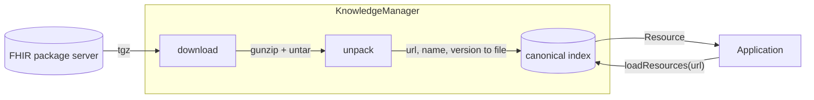

# Kotlin FHIR Knowledge Manager

[](https://central.sonatype.com/artifact/dev.ohs.fhir/fhir-knowledge)
[](https://central.sonatype.com/artifact/dev.ohs.fhir/fhir-knowledge-android)
[](https://central.sonatype.com/artifact/dev.ohs.fhir/fhir-knowledge-desktop)
[](https://central.sonatype.com/artifact/dev.ohs.fhir/fhir-knowledge-iossimulatorarm64)
[](https://central.sonatype.com/artifact/dev.ohs.fhir/fhir-knowledge-iosarm64)
[](https://central.sonatype.com/artifact/dev.ohs.fhir/fhir-knowledge-wasm-js)
[](https://central.sonatype.com/artifact/dev.ohs.fhir/fhir-knowledge-js)
[](https://opensource.org/licenses/Apache-2.0)

A Kotlin Multiplatform library for managing HL7 FHIR R4 knowledge artifacts on device. It installs
versioned FHIR NPM packages together with their dependencies, indexes the resources they hold, and
resolves those resources by canonical URL.



## Supported platforms

The library's support for different
[target platforms](https://kotlinlang.org/docs/multiplatform-dsl-reference.html#targets)
is listed in the following table:

| Target platform                    | Gradle target       | Artifact suffix      | Support |
|:-----------------------------------|:--------------------|:---------------------|:--------|
| Kotlin/JVM (Desktop)               | `jvm("desktop")`    | `-desktop`           | ✅       |
| Android applications and libraries | `android`           | `-android`           | ✅       |
| iOS (Apple silicon simulator)      | `iosSimulatorArm64` | `-iossimulatorarm64` | ✅       |
| iOS (device)                       | `iosArm64`          | `-iosarm64`          | ✅       |
| Kotlin/Wasm (browser)              | `wasmJs`            | `-wasm-js`           | ⚠️       |
| Kotlin/JS (browser)                | `js`                | `-js`                | ⚠️       |

The browser has no file system that okio implements and no gzip that any Kotlin library implements,
so the web targets support a subset. The index persists to the Origin Private File System, and
`index`, `import`, `loadResources` and `delete` work against a `FileSystem` you pass to
`KnowledgeManager.create` — over bundled assets, for instance. `install` is unavailable, since
unpacking a downloaded package needs gzip.

### Why okio rather than kotlinx-io

kotlinx-io is the newer library and Ktor 3 already places it on the classpath, so it is the natural
question. Measured against what this library needs, it is not yet a replacement:

| | okio 3.17.0 | kotlinx-io 0.9.0 |
|:---|:---|:---|
| Gzip, which every FHIR NPM package needs | JVM and native | none published |
| File system on JVM, Android and native | ✅ | ✅ |
| File system in a browser | ❌ | ❌ — its web implementation calls Node's `fs` |
| In-memory file system for tests | ✅ | ❌ |

Adopting it today would remove working decompression from Android, desktop and iOS without adding
a browser target. Worth revisiting once kotlinx-io publishes compression or a browser file system.
Decompression is already declared as a platform-specific function, so a target that needs a
different implementation costs one `actual` rather than a change to shared code.

## User guide

### Adding the library dependency to your project

First make sure to include the `mavenCentral()` repository in the `build.gradle.kts` file in your
project root.

```
// build.gradle.kts
repositories {
    // Other repositories such as gradlePluginPortal() and google()
    mavenCentral()
}
```

The knowledge manager returns resources from `dev.ohs.fhir:fhir-model`, so add it next to
`fhir-knowledge` in the module that uses them.

#### Kotlin Multiplatform projects

Add the dependencies to the shared `commonMain` source set within the `kotlin` block of the
module's `build.gradle.kts` file (e.g. `composeApp/build.gradle.kts` or `shared/build.gradle.kts`).

```
// e.g., composeApp/build.gradle.kts or shared/build.gradle.kts
kotlin {
    sourceSets {
        commonMain.dependencies {
            implementation("dev.ohs.fhir:fhir-knowledge:2.0.0-alpha01")
            implementation("dev.ohs.fhir:fhir-model:1.0.0-rc03")
        }
    }
}
```

#### Android projects

Add the dependencies to the `dependencies` block in the module's `build.gradle.kts` file (e.g.
`app/build.gradle.kts`).

```
// e.g., app/build.gradle.kts
dependencies {
    implementation("dev.ohs.fhir:fhir-knowledge:2.0.0-alpha01")
    implementation("dev.ohs.fhir:fhir-model:1.0.0-rc03")
}
```

### Installing and resolving knowledge artifacts

Create a `KnowledgeManager` once at startup, and `close()` it when the application is done with it.
On Android pass the application `Context`; on desktop pass the application id, which keeps the
database and package cache under `~/.fhir-knowledge/<application id>`; on iOS and the web pass
`Unit` (the default).

```kotlin
val knowledgeManager = KnowledgeManager.create(platformContext) // Android: applicationContext; desktop: the application id

// Downloads the package and its transitive dependencies, then indexes what they hold.
knowledgeManager.install(FhirNpmPackage("anc-cds", "0.3.0"))

// Resolve by canonical URL, optionally pinned to a version.
val library =
    knowledgeManager
        .loadResources("http://fhir.org/guides/who/anc-cds/Library/WHOCommon|0.3.0")
        .single() as Library
```

`import` indexes a package that is already unpacked, and `index` records a single artifact held in
an immutable file, such as one bundled with the application. `delete` removes the files of a package
that `install` downloaded; a directory passed to `import` is left as it is.

A file is indexed when its `resourceType` is one of the 29 FHIR R4 metadata resources —
`ActivityDefinition`, `Library`, `Measure`, `PlanDefinition`, `Questionnaire`, `StructureDefinition`,
`ValueSet` and the rest. `import` skips anything else, since an unpacked package also carries files
that are not FHIR resources; `index` raises on it, because naming a file explicitly and having it
quietly ignored would be the worse surprise. `loadResources` returns an empty result for an artifact
that was never indexed.

### Serving the workflow library's CanonicalResolver

[kotlin-fhir-workflow](https://github.com/ohs-foundation/kotlin-fhir-workflow) resolves knowledge
artifacts through a one-method `CanonicalResolver`, which asks for any resource type — a `Library`
or `ValueSet` resolves the same way as a `PlanDefinition`. That is what this library indexes, so the
adapter is a one-liner. Neither library depends on the other; it lives in your application:

```kotlin
class KnowledgeCanonicalResolver(private val knowledgeManager: KnowledgeManager) :
    CanonicalResolver {

    override suspend fun resolve(type: ResourceType, canonical: String): Resource? =
        knowledgeManager.loadResources(canonical).firstOrNull {
            it::class.simpleName == type.getCode()
        }
}
```

```kotlin
val operator = FhirOperator(repository, resolver = KnowledgeCanonicalResolver(knowledgeManager))
val carePlan =
    operator.generateCarePlan(
        planDefinitionCanonical = "http://fhir.org/guides/who/anc-cds/PlanDefinition/anc|0.3.0",
        subject = patient,
        today = today,
    )
```

## Security

Package servers are treated as untrusted. Unpacking rejects an archive entry whose name climbs out
of the package directory, and each archive header is checked against its own checksum before its
size field is used to allocate.

## Building

```shell
./gradlew :knowledge:assemble                 # all four targets
./gradlew :knowledge:desktopTest              # the full test suite
./gradlew :knowledge:testAndroidHostTest
./gradlew :knowledge:iosSimulatorArm64Test    # needs macOS
```

The suite runs on Android, desktop and iOS. Android host tests pull in the host build of the
bundled SQLite driver, whose Android artifact carries device binaries only. The web targets are
verified by compiling the library and the suite against them; running the suite in a browser needs
a cross-origin isolated page for the Origin Private File System, which Karma does not serve.
